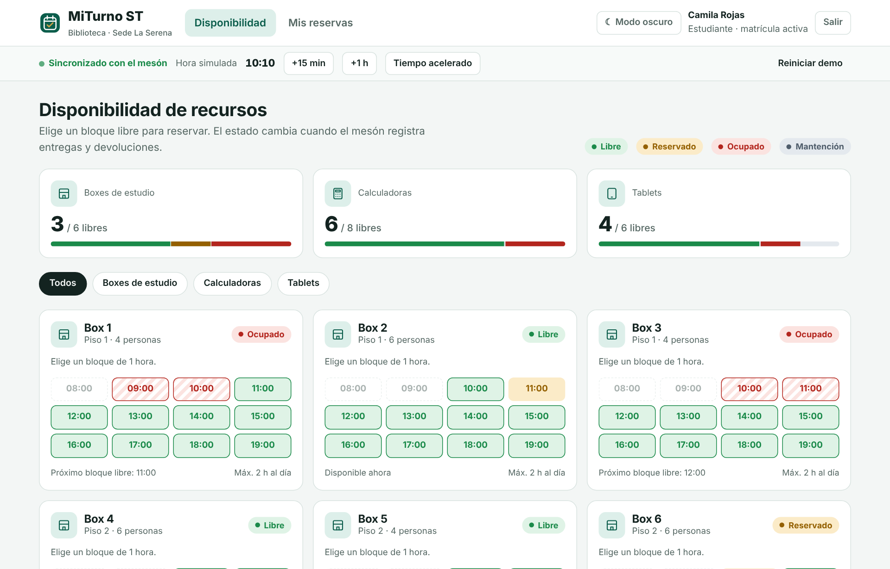
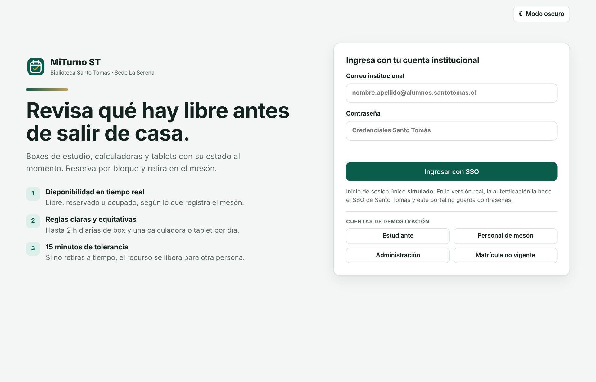
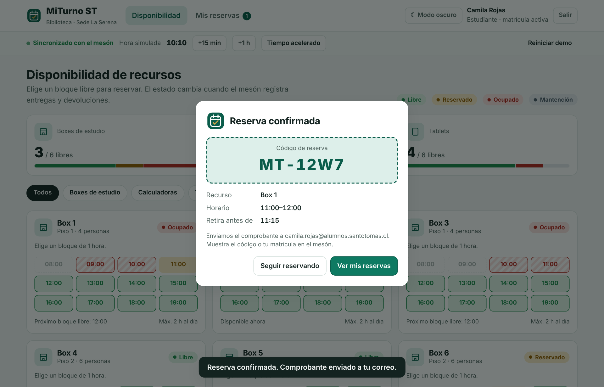
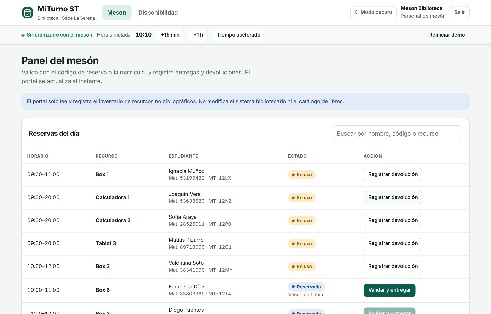
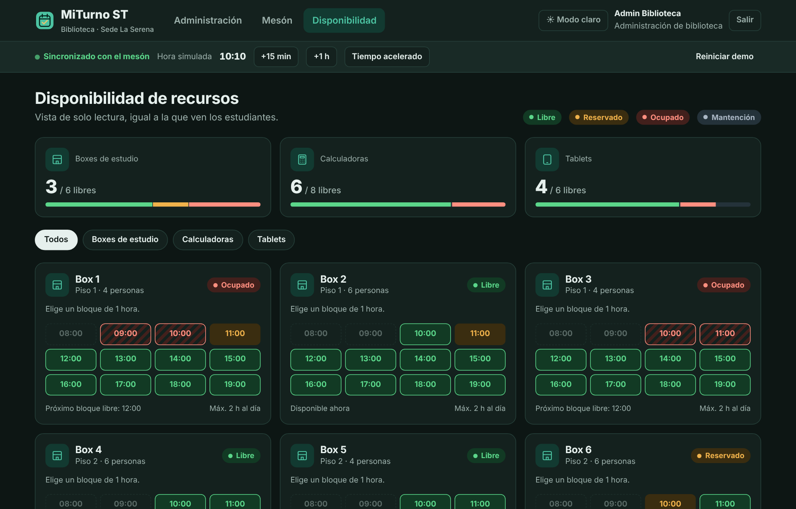

# 📅 MiTurno ST

**Revisa qué hay libre en la biblioteca antes de salir de casa.**

Portal web para consultar y reservar boxes de estudio, calculadoras y tablets de la Biblioteca Santo Tomás, sede La Serena.

---

## 🎯 El problema

Los estudiantes no pueden saber, sin ir a la sede, si hay recursos libres en la biblioteca. Todo se consulta en el mesón: hay viajes en vano, filas en horas peak y consultas repetitivas para el personal.

## 💡 La solución

Una "máscara" web que **no modifica** el sistema bibliotecario y muestra el estado de cada recurso en tiempo real.

| | Función |
|---|---|
| 🟢 | **Disponibilidad en tiempo real**: libre, reservado, ocupado o en mantención |
| 📲 | **Reserva desde el teléfono** por bloques horarios, con código de comprobante |
| ⚖️ | **Reglas equitativas**: máx. 2 h diarias de box, 1 calculadora y 1 tablet por día, sin reservas simultáneas |
| ⏱️ | **Liberación automática** si no se retira en 15 minutos |
| 🧾 | **Panel del mesón** para validar entregas y devoluciones con código o matrícula |
| 🛠️ | **Administración**: indicadores, parámetros, catálogo, mantención y auditoría exportable |

## 🖥️ Capturas

<table>
<tr>
<td width="50%"> Ingreso con cuenta institucional (simulado)</td>
<td width="50%"> Reserva confirmada con código</td>
</tr>
<tr>
<td> Panel del mesón</td>
<td> Modo oscuro</td>
</tr>
</table>

## 🚀 Probarlo

1. Abre **https://jojedagth.github.io/MiTurnoST/** (o descarga el repositorio y abre `Repositorio_MiTurnoST/prototipo/index.html`).
2. Entra con una cuenta de demostración:

| Botón | Correo | Qué puede hacer |
|---|---|---|
| Estudiante | camila.rojas@alumnos.santotomas.cl | Reservar y cancelar |
| Personal de mesón | meson.biblioteca@santotomas.cl | Entregar y recibir recursos |
| Administración | admin.biblioteca@santotomas.cl | Parámetros, catálogo y auditoría |
| Matrícula no vigente | inactivo.demo@alumnos.santotomas.cl | Ver el rechazo de acceso |

3. Usa **+15 min** o **+1 h** en la barra superior para simular el paso del tiempo.

> ⚠️ Prototipo con datos ficticios. El SSO, el correo y la conexión con el inventario de la biblioteca están **simulados**.

## 📂 Contenido

| Ruta | Qué es |
|---|---|
| [`Repositorio_MiTurnoST/prototipo/`](Repositorio_MiTurnoST/prototipo/) | Prototipo (un solo archivo HTML, sin dependencias) |
| [`Repositorio_MiTurnoST/docs/manual_instalacion.md`](Repositorio_MiTurnoST/docs/manual_instalacion.md) | Manual de instalación y despliegue |
| [`Repositorio_MiTurnoST/docs/manual_usuario.md`](Repositorio_MiTurnoST/docs/manual_usuario.md) | Manual de usuario ilustrado |
| [`Repositorio_MiTurnoST/docs/documentacion_tecnica.md`](Repositorio_MiTurnoST/docs/documentacion_tecnica.md) | Documentación técnica interna |
| [`Repositorio_MiTurnoST/tests/`](Repositorio_MiTurnoST/tests/) | 26 pruebas automatizadas (Playwright) |
| [`InformeFinal_MiTurnoST.docx`](InformeFinal_MiTurnoST.docx) | Informe final del proyecto |

## 👥 Equipo

**PateoEnVano Inc** · Ingeniería en Informática, Instituto Profesional Santo Tomás, sede La Serena

| Integrante | Roles |
|---|---|
| Julián Ojeda | Gerente de Proyecto / Scrum Master · UI/UX y Frontend · QA y Capacitación |
| Benjamín Santander | Arquitecto de Sistemas y Seguridad · Backend · QA |
| Martín Araya | Administrador de Bases de Datos · Backend e Integración |

Asignatura: Gestión de Proyectos y Equipos de Trabajo · Docente: Paola Celis Lagos
