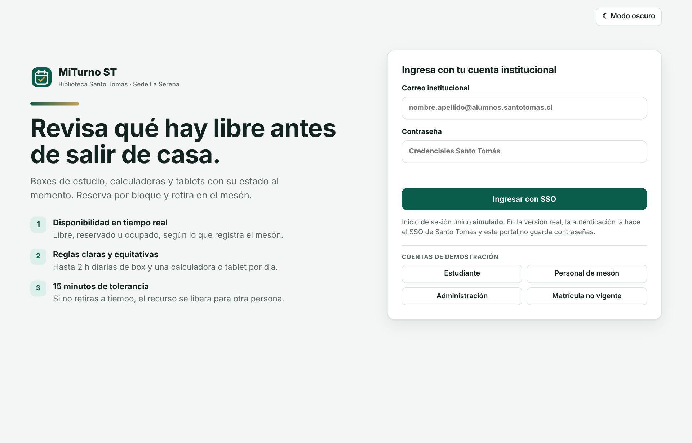
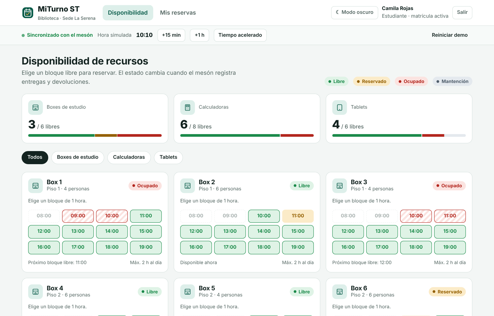
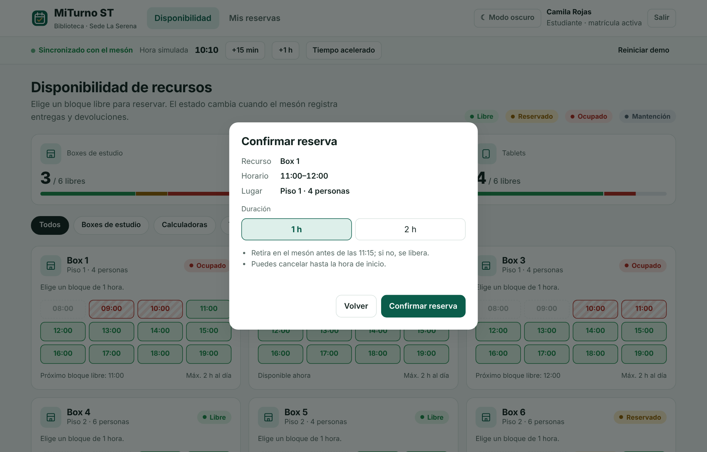
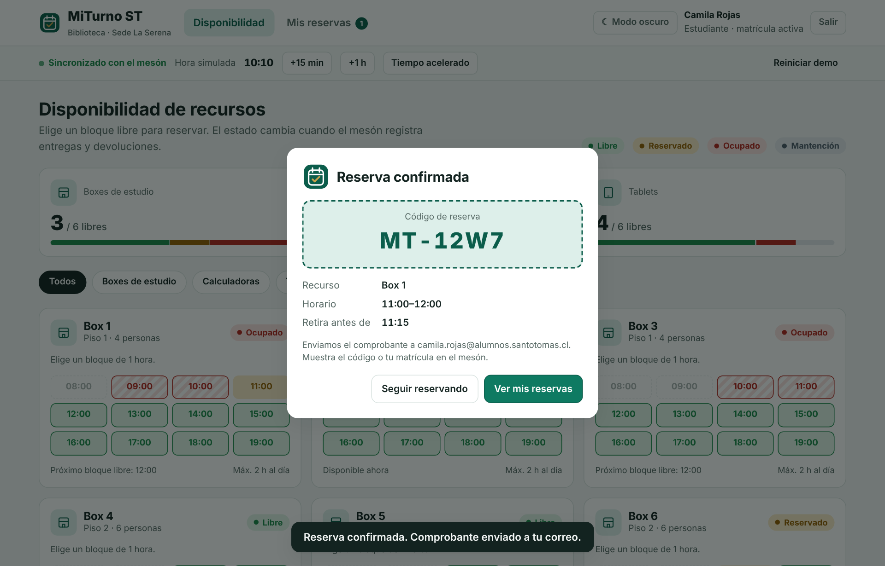
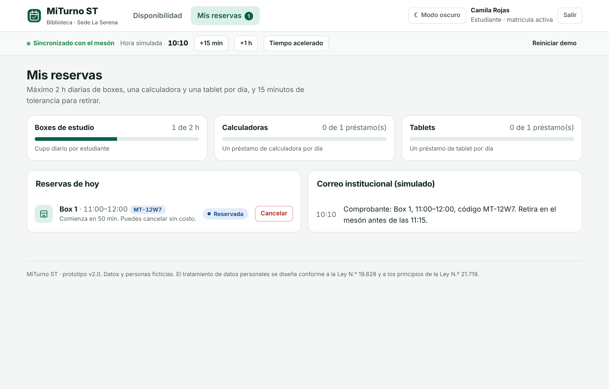
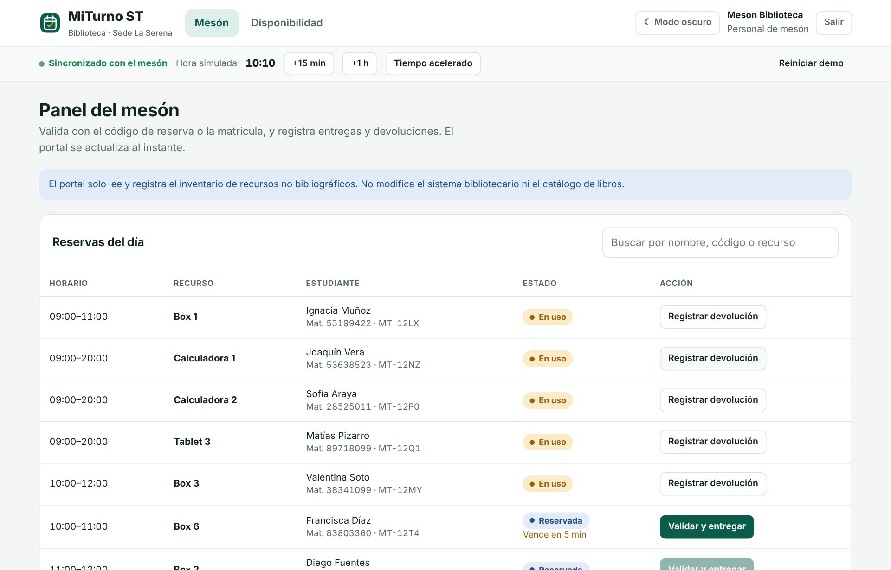
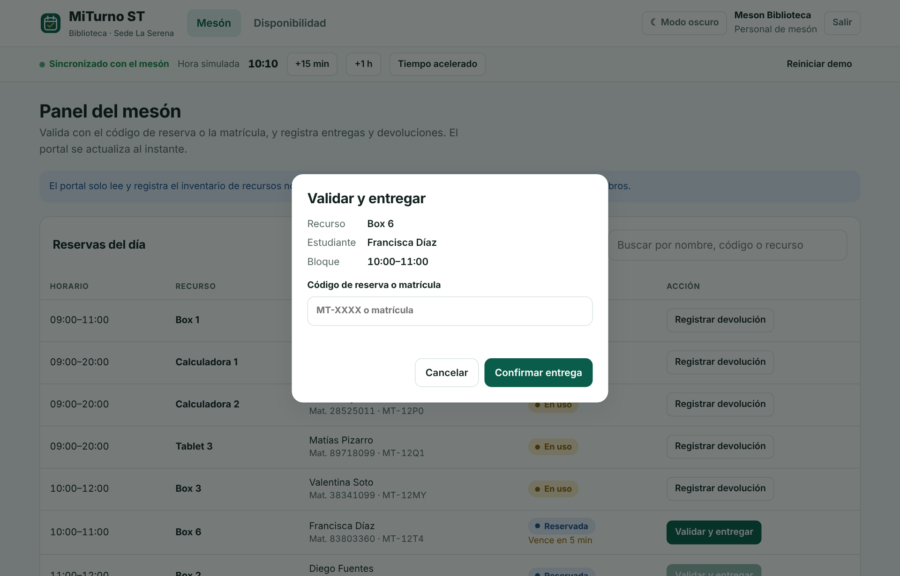
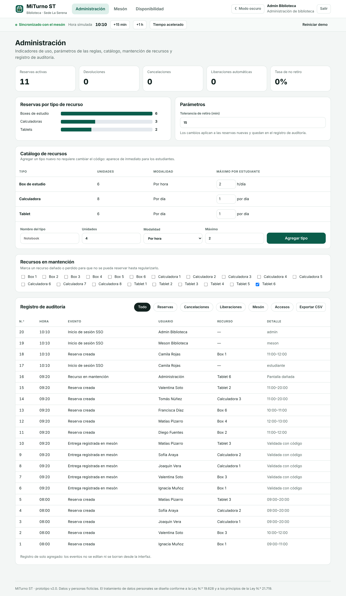
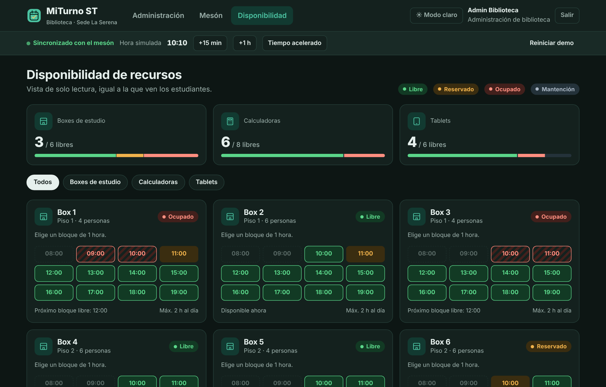
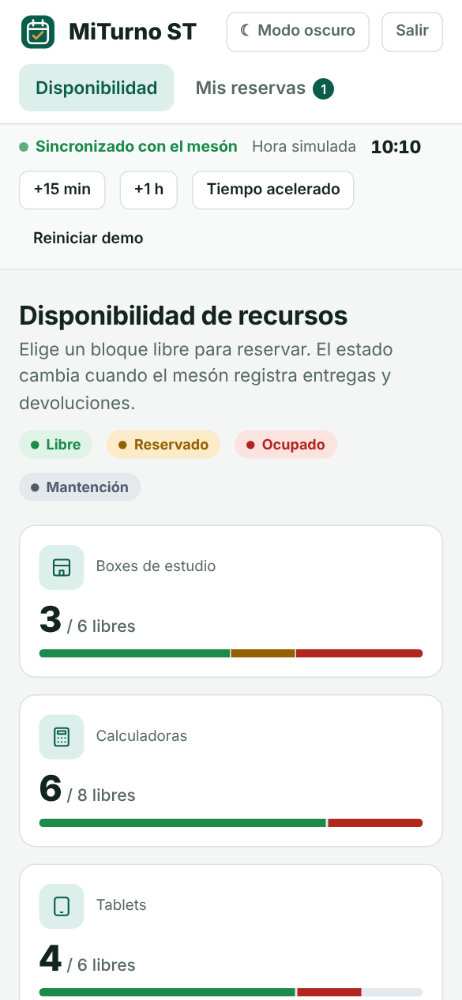

# Manual de usuario · MiTurno ST (prototipo v2)

MiTurno ST muestra en tiempo real qué boxes de estudio, calculadoras y tablets de la biblioteca están libres, y permite reservarlos antes de ir a la sede.

> En el prototipo, el reloj es **simulado** (empieza a las 10:10). Usa **+15 min**, **+1 h** o **Tiempo acelerado** para ver cómo cambian los estados.

---

## 1. Ingresar

1. Escribe tu correo institucional y tu contraseña, y pulsa **Ingresar con SSO**.
2. En el prototipo también puedes usar los botones de **Cuentas de demostración**.

Solo entran estudiantes con matrícula activa (`@alumnos.santotomas.cl`) y personal de la biblioteca (`@santotomas.cl`). Un correo externo o una matrícula no vigente se rechazan con un mensaje.

---

## 2. Estudiantes

### 2.1 Ver la disponibilidad

- Arriba ves cuántos recursos de cada tipo están libres. Toca un resumen o un filtro para ver solo ese tipo.
- Cada tarjeta muestra el estado actual y los bloques del día:

| Color | Significa |
|---|---|
| Verde con borde | Libre, se puede reservar |
| Amarillo | Reservado por otra persona |
| Rojo rayado | Ocupado (ya se retiró) |
| Gris rayado | No disponible o en mantención |
| Punteado | Bloque que ya pasó |

### 2.2 Reservar

1. Toca un bloque verde.
2. En boxes, elige la duración (1 o 2 h). Las calculadoras y tablets se prestan hasta el cierre.
3. Pulsa **Confirmar reserva**.

Recibirás un **código de reserva** (por ejemplo `MT-12W7`) y un comprobante en tu correo. Muéstralo en el mesón.

**Reglas:**
- Máximo 2 horas diarias de boxes.
- Una calculadora y una tablet por día.
- No puedes tener dos recursos del mismo tipo a la misma hora.
- Tienes **15 minutos** desde el inicio del bloque para retirar. Si no, la reserva se cancela sola y el recurso queda libre.

### 2.3 Mis reservas y cancelación

- Muestra tu cupo usado del día, tus reservas y los avisos enviados a tu correo.
- Pulsa **Cancelar** para liberar el recurso. Solo se puede antes de la hora de inicio.

---

## 3. Personal del mesón

1. En **Reservas del día** busca por nombre, código o recurso.
2. Cuando llegue el estudiante, pulsa **Validar y entregar**.

3. Escribe el **código de reserva** o la **matrícula** y pulsa **Confirmar entrega**. El recurso pasa a *Ocupado* en el portal.
4. Al recibir el recurso, pulsa **Registrar devolución**. El recurso vuelve a *Libre*.

Si una reserva muestra "Vence en X min", al estudiante le queda ese tiempo para retirar.

---

## 4. Administración

| Sección | Para qué sirve |
|---|---|
| Indicadores | Reservas activas, devoluciones, cancelaciones, liberaciones automáticas y tasa de no retiro |
| Parámetros | Cambiar los minutos de tolerancia |
| Catálogo | Cambiar el máximo por estudiante y **agregar nuevos tipos** de recurso (por ejemplo, notebooks) |
| Recursos en mantención | Bloquear un recurso dañado o perdido para que nadie lo reserve |
| Registro de auditoría | Ver todos los eventos, filtrarlos y **exportarlos a CSV** |

---

## 5. Otras opciones

- **Modo oscuro:** botón en la barra superior.

- **En el teléfono:** la interfaz se adapta a pantallas pequeñas.

- **Reiniciar demo:** devuelve el prototipo a su estado inicial.
